# 1. Introduction

Une carte Magic a un type, une couleur, un coût, et souvent une force et une endurance. Dans ce projet, nous nous intéressons aux **créatures** et aux caractéristiques *qui vont ensemble*. Nous cherchons d'abord à savoir si la taille d'une créature, c'est-à-dire son coût en mana, sa force et son endurance, est liée à son prix, en tenant compte de la rareté et des rééditions. Nous cherchons ensuite à déterminer si certains types de créatures, comme les Elfes, les Gobelins ou les Zombies, sont associés à certaines couleurs.

Nous sommes deux sur ce projet, Keren Courtois et Célestin Cécilien. Nous utilisons les méthodes vues en cours, appliquées aux données de `data/cards.csv` : une ACP sur les variables numériques, une AFC entre le type de créature et l'identité de couleur, ainsi qu'une ACM qui ajoute la rareté. Nous avons également réalisé un k-means et une classification hiérarchique afin d'étudier les groupes de créatures et de voir s'ils correspondent aux dimensions mises en évidence par l'ACP. Enfin, nous comparons les k plus proches voisins à un arbre de décision pour prédire la classe de prix.

Les résultats présentés dans la suite proviennent de `figures/resultats.txt`, généré par `main.py`. Les parts de ligne utilisées pour interpréter l'AFC sont calculées à partir des effectifs déjà présents dans ce fichier.

# 2. Jeu de données

Le jeu de données analysé est `data/cards.csv`. Les classes d'analyse utilisent uniquement ce fichier. Il est d'abord construit par `ConstructeurCartes`, lancé depuis `main.py`, qui télécharge deux fichiers publics de MTGJSON depuis `https://mtgjson.com/api/v5/` :

- `AllPrintings.sqlite`, qui contient les impressions et les éditions
- `AllPricesToday.json.gz`, qui contient le dernier prix retail de chaque impression.

Les fichiers téléchargés sont stockés dans `data/cache`. Le script ne lit aucun fichier provenant d'un autre emplacement.

Une ligne correspond à un **nom de carte**, et non à une impression. Les caractéristiques de la carte, y compris sa rareté, sont celles de son édition la plus récente. La colonne `printing_count` indique le nombre d'impressions de ce nom. Le mana, la force et l'endurance changent rarement d'une impression à l'autre, alors que la rareté peut changer.

La colonne `retail_price` correspond à la moyenne, en dollars, du prix retail papier en finition normale chez TCGPlayer, Card Kingdom et Mana Pool. Pour chaque impression, nous faisons d'abord la moyenne des fournisseurs disponibles, puis nous faisons la moyenne des impressions du même nom qui possèdent un prix. Cardmarket n'est pas utilisé car ses prix sont exprimés en euros.

Le fichier utilisé dans cette analyse correspond aux données du 1er octobre 2026. Si le constructeur est relancé à une autre date, les prix publiés ce jour-là remplacent les précédents et le fichier CSV est reconstruit. Lorsqu'aucun prix retail n'est disponible pour une carte, la valeur reste vide.

| Étape                          | Effectif |
| ------------------------------ | -------: |
| Noms dans `cards.csv`          |   35 081 |
| Dont le type contient Creature |   19 169 |
| Sans prix retail normal        |    1 540 |

Colonnes utilisées :

| Colonne                 | Sens                                                              |
| ----------------------- | ----------------------------------------------------------------- |
| `types`                 | types de la carte, par exemple `Creature` ou `Artifact, Creature` |
| `subtypes`              | types de créature, par exemple `Elf, Druid`                       |
| `color_identity`        | identité de couleur, par exemple `G` ou `B, R`                    |
| `mana_value`            | coût en mana                                                      |
| `power`, `toughness`    | force et endurance, parfois non numériques (`*`)                  |
| `rarity`, `rarity_rank` | rareté, codée de 1 pour commune à 5 pour spéciale                 |
| `printing_count`        | nombre d'impressions                                              |
| `retail_price`          | prix retail papier du jour, en dollars, finition normale          |
| `layout`                | mise en page                                                      |

Une créature est une carte dont `types` contient le terme `Creature`. Cette définition inclut donc également les créatures-artefacts. Le CSV contient 19 169 créatures.

Le CSV contient également d'autres informations, notamment le texte d'oracle, le coût en mana, les couleurs imprimées, les supertypes, les mots-clés, la loyauté, le rang et le sel EDHREC, le marqueur game changer, les rôles de commandant (`can_commander` et les formats voisins), le nombre de rulings et une colonne `legality_*` pour chaque format, avec les valeurs Legal, Banned ou Restricted. Le détail des informations provenant de l'édition retenue et de celles regroupées au niveau du nom est décrit dans `data/extraction.txt`.

# 3. Nettoyage

Les différentes méthodes n'utilisent pas exactement les mêmes variables. Nous travaillons donc avec deux populations.

L'AFC et l'ACM utilisent toutes les créatures du CSV. Lorsqu'un type ou une couleur est manquant, le cas est traité séparément dans les analyses concernées, mais la carte reste présente dans le fichier.

L'ACP, le k-means, la CAH et le bonus supervisé utilisent uniquement les créatures dont le mana, la force, l'endurance, la rareté et le prix sont numériques. Cela retire 1 144 créatures sur les 19 169 initiales, principalement à cause des forces ou endurances indiquées par `X`, ainsi que de quelques prix manquants. Nous n'imputons pas ces valeurs, car remplacer une force ou une endurance manquante par une médiane reviendrait à lui attribuer une valeur qui n'est pas observée.

Il reste **18 025** créatures, dont 13 664 monocolores, 3 577 multicolores et 784 incolores.

Avant l'ACP, le nombre d'impressions et le prix sont transformés avec `log(1 + x)` afin de réduire l'influence des cartes très rééditées ou beaucoup plus chères que les autres. Le mana, la force, l'endurance et la rareté restent sur leur échelle d'origine. Toutes les variables sont ensuite centrées et réduites, de manière à avoir une moyenne de 0 et un écart-type de 1.

# 4. ACP

L'ACP de scikit-learn est appliquée aux six variables, sans fixer à l'avance le nombre de composantes.

| Dimension | Valeur singulière | Valeur propre | % variance | % cumulé |
| --------- | ----------------: | ------------: | ---------: | -------: |
| Dim1      |            219,42 |          2,67 |      44,52 |    44,52 |
| Dim2      |            164,94 |          1,51 |      25,15 |    69,67 |
| Dim3      |            113,87 |          0,72 |      11,99 |    81,66 |
| Dim4      |             93,34 |          0,48 |       8,06 |    89,71 |
| Dim5      |             80,92 |          0,36 |       6,05 |    95,77 |
| Dim6      |             67,64 |          0,25 |       4,23 |   100,00 |

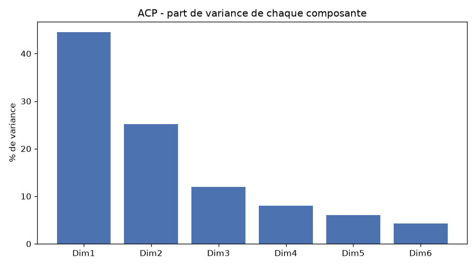{width=75%}

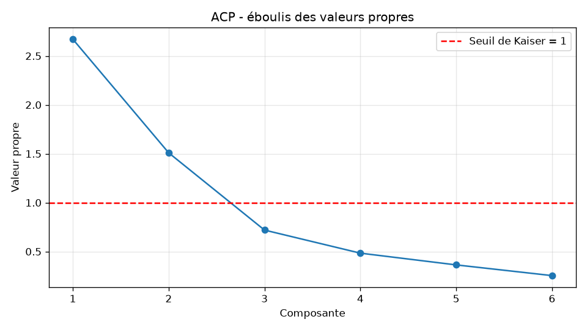{width=75%}

Deux composantes ont une valeur propre supérieure ou égale à 1. Le premier plan représente **69,7 %** de la variance totale. Nous retenons donc ces deux dimensions pour l'interprétation. Les composantes suivantes restent sous le seuil de Kaiser.

## Corrélations

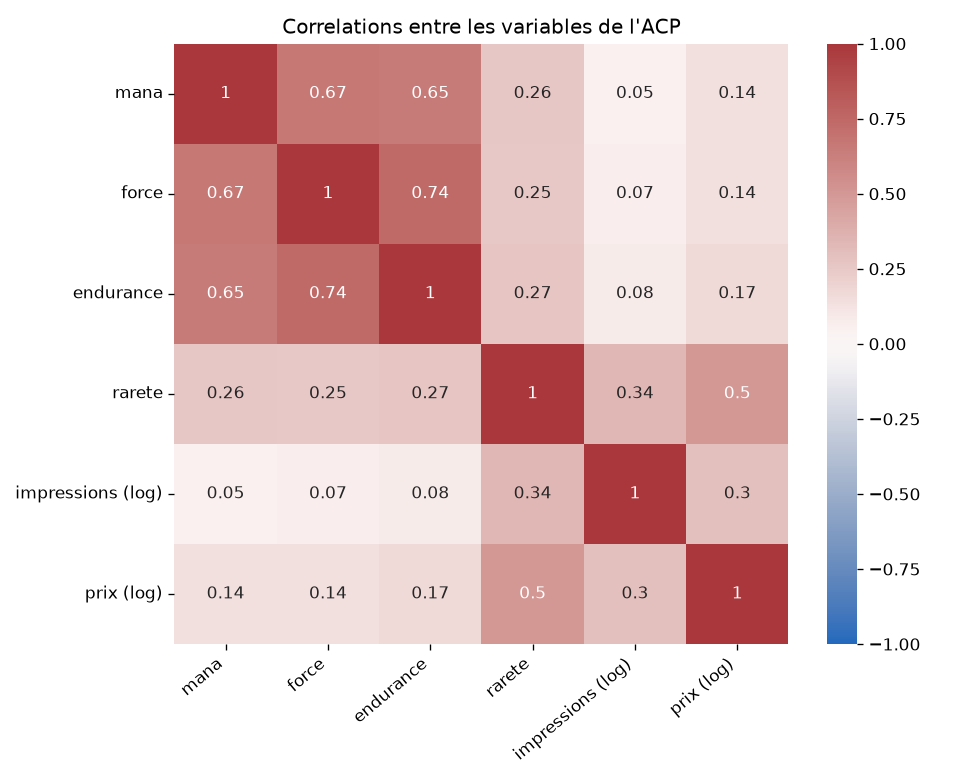{width=80%}

Les corrélations les plus fortes concernent les variables de **gabarit**. La force et l'endurance sont corrélées à 0,74, la force et le mana à 0,67, et l'endurance et le mana à 0,65. Le prix est surtout lié à la rareté, avec une corrélation de 0,50, et dans une moindre mesure au nombre de rééditions, avec une corrélation de 0,30. Il est peu corrélé au mana (0,14), à la force (0,14) et à l'endurance (0,17). Le prix d'une créature n'est donc pas fortement lié à son gabarit.

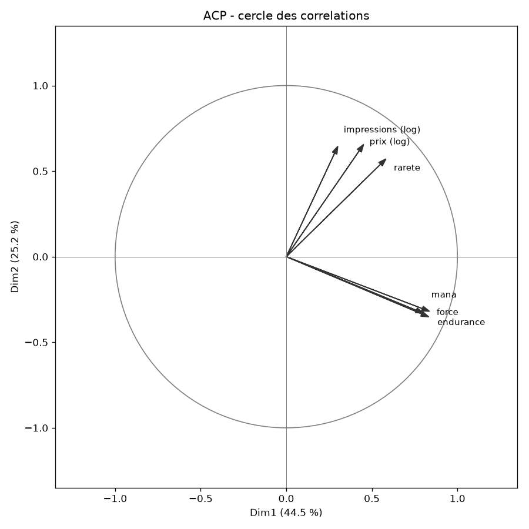{width=70%}

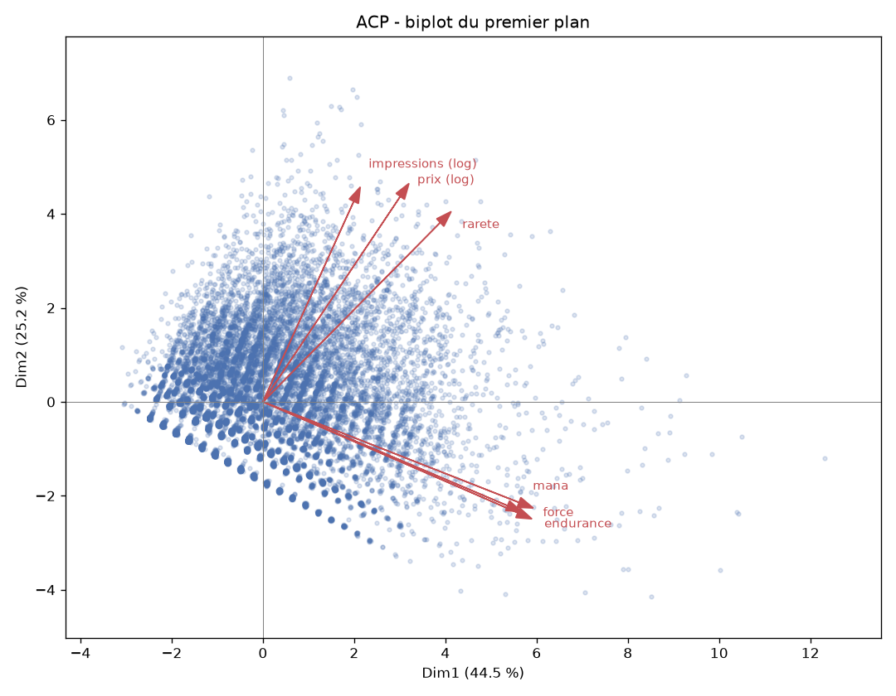{width=80%}

Les charges correspondent aux corrélations entre les variables et les composantes. Elles permettent de préciser la lecture du cercle des corrélations.

| Variable          |  Dim1 |   Dim2 |   Dim3 |
| ----------------- | ----: | -----: | -----: |
| Endurance         | 0,837 | -0,319 |  0,051 |
| Force             | 0,833 | -0,352 |  0,072 |
| Mana              | 0,801 | -0,330 |  0,012 |
| Rareté            | 0,583 |  0,572 | -0,229 |
| Prix (log)        | 0,452 |  0,656 | -0,416 |
| Impressions (log) | 0,301 |  0,646 |  0,697 |

**Dim1 (44,5 %)** correspond principalement au gabarit. L'endurance, la force et le mana ont tous une charge supérieure à 0,80. Le prix n'y est qu'à 0,452. Les créatures situées vers la droite du plan ont donc tendance à avoir un coût en mana, une force et une endurance plus élevés.

Dans le tableau des extrêmes, `B.F.M. (Big Furry Monster)` atteint 57,98 sur Dim1 et -28,65 sur Dim2. Le cadre des figures s'arrête avant ce point. Les cartes suivantes dans cette direction sont `Emrakul, the Aeons Torn`, à 12,32 sur Dim1, puis `Worldspine Wurm` et `Impervious Greatwurm`. À l'autre extrémité, autour de -3, on trouve de petites créatures comme `Clockwork Beetle`, `Spike Drone`, `Iron Apprentice` et `Little Girl`. Les charges et les coordonnées sont calculées sur les 18 025 créatures. `B.F.M. (Big Furry Monster)` se distingue nettement des autres créatures par sa position très éloignée du centre du graphique. Il apparaît donc comme une valeur extrême sur le premier plan de l'ACP.

**Dim2 (25,2 %)** est davantage lié au prix, aux impressions et à la rareté. Le prix a une charge de 0,656, les impressions de 0,646 et la rareté de 0,572. Dans la partie haute du plan se trouvent notamment `Birds of Paradise`, `Lord of Atlantis`, `Royal Assassin`, `Vesuvan Doppelganger` et `Snapcaster Mage`, qui ont un prix ou un nombre d'impressions élevés par rapport à leur gabarit. Dans la partie basse, `Autochthon Wurm` et `Impervious Greatwurm` correspondent à de gros gabarits qui ne suivent pas le même profil de prix et de rééditions.

La troisième composante a une valeur propre de 0,72 et reste donc sous le seuil de Kaiser. Nous ne l'interprétons pas comme un axe principal. Ses charges montrent néanmoins que les impressions et le prix ne suivent pas exactement la même direction : les impressions ont une charge de 0,697 tandis que le prix a une charge de -0,416.

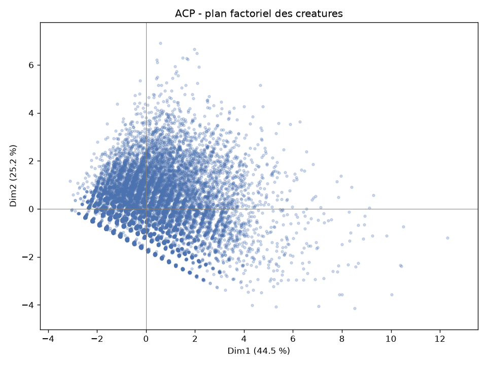{width=75%}

Le nuage est concentré autour de l'origine, avec une longue queue du côté des gros gabarits. `B.F.M. (Big Furry Monster)`, situé à 57,98 sur Dim1 et -28,65 sur Dim2, reste en dehors du cadre de la figure.

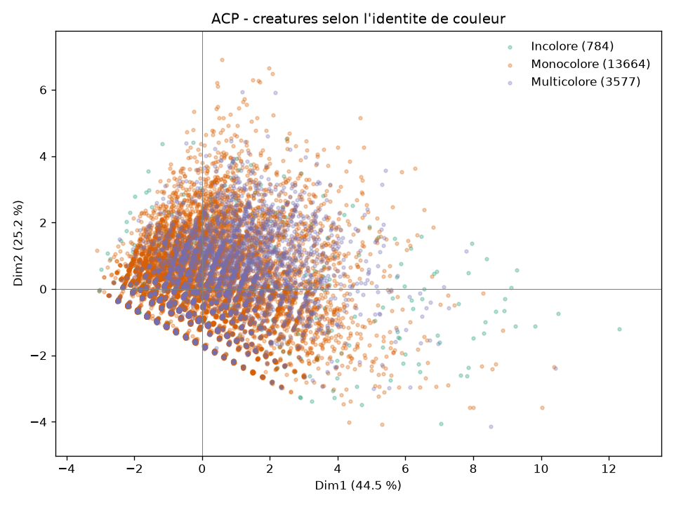{width=75%}

La coloration des individus selon leur identité de couleur, en distinguant les créatures incolores, monocolores et multicolores, ne fait pas apparaître de séparation nette. Sur ce plan, la couleur ne semble donc pas organiser directement le gabarit ou le prix. Nous étudions plus précisément le lien entre couleur et type de créature avec l'AFC.

# 5. AFC : type de créature et couleur

Nous cherchons ici à étudier l'association entre les types de créatures et les couleurs. Les deux variables peuvent prendre plusieurs valeurs, une carte peut par exemple avoir les types `Elf, Druid` et l'identité de couleur `G, W`. Le tableau obtenu ne constitue donc **pas** une partition des 19 169 créatures.

Pour chaque créature, nous ajoutons 1 pour chaque couple formé entre l'un de ses sous-types et l'une des couleurs de son identité. Une créature incolore, dont l'identité de couleur est vide, est comptée dans la colonne Incolore. Une créature à la fois Elfe et Druide, avec une identité verte et blanche, contribue ainsi aux quatre cases Elfe-Vert, Elfe-Blanc, Druide-Vert et Druide-Blanc. Cette construction produit 41 688 couples.

De nombreux sous-types sont rares, puisqu'il en existe plusieurs centaines. Nous conservons uniquement ceux qui apparaissent au moins **400** fois, soit 24 types. Le tableau retenu contient 24 088 comptes et concerne 12 909 créatures distinctes. Les types plus rares sont exclus plutôt que regroupés dans une catégorie "Autre", qui aurait augmenté artificiellement une modalité déjà très fréquente.

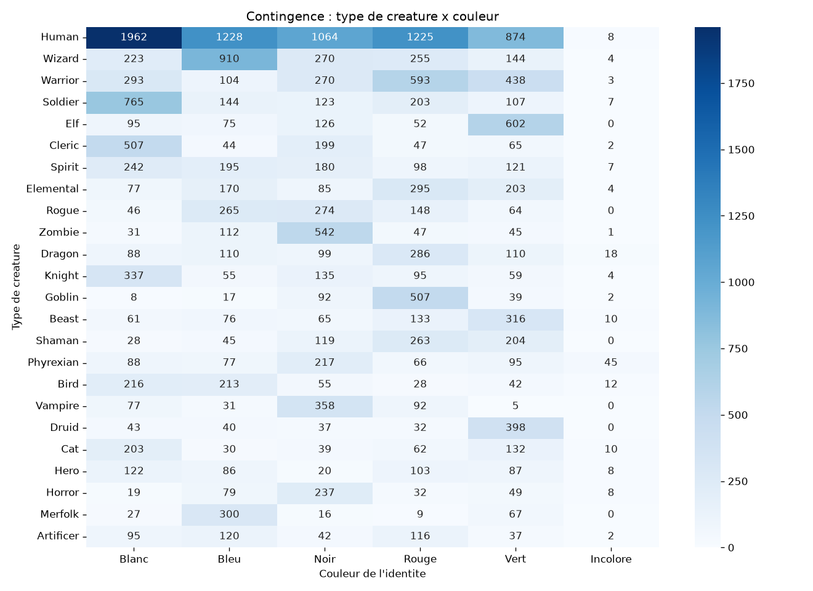{width=92%}

Un effectif élevé dans une case peut simplement venir du fait que le type est fréquent. Pour mieux mesurer la répartition des couleurs à l'intérieur de chaque type, nous rapportons donc chaque effectif à la somme de sa ligne. Les parts présentées ci-dessous sont calculées à partir du tableau enregistré dans `figures/resultats.txt`.

| Type    | Couleur | Effectif | Ligne |  Part |
| ------- | ------- | -------: | ----: | ----: |
| Human   | Blanc   |    1 962 | 6 361 | 30,8% |
| Wizard  | Bleu    |      910 | 1 806 | 50,4% |
| Soldier | Blanc   |      765 | 1 349 | 56,7% |
| Elf     | Vert    |      602 |   950 | 63,4% |
| Zombie  | Noir    |      542 |   778 | 69,7% |
| Goblin  | Rouge   |      507 |   665 | 76,2% |
| Cleric  | Blanc   |      507 |   864 | 58,7% |
| Druid   | Vert    |      398 |   550 | 72,4% |
| Vampire | Noir    |      358 |   563 | 63,6% |
| Merfolk | Bleu    |      300 |   419 | 71,6% |
| Dragon  | Rouge   |      286 |   711 | 40,2% |

Les Gobelins sont rouges dans 76,2 % des cas, les Druides sont verts dans 72,4 % des cas, les Ondins sont bleus dans 71,6 % des cas et les Zombies sont noirs dans 69,7 % des cas. Les Elfes sont verts dans 63,4 % des cas et les Vampires noirs dans 63,6 %. Les Soldats et les Clercs sont plus souvent blancs que d'une autre couleur, mais cette tendance est moins marquée. Pour les Sorciers, le bleu représente environ la moitié de la ligne.

Les Humains ont une répartition différente. Le blanc constitue leur plus grande catégorie, avec 1 962 occurrences, mais cela ne représente que 30,8 % des 6 361 comptes de la ligne. Le bleu et le rouge représentent chacun 19,3 %, le noir 16,7 % et le vert 13,7 %. Les Humains sont donc présents dans les cinq couleurs. L'effectif de 1 962 ne suffit pas, à lui seul, à les caractériser comme un type blanc.

Les Dragons sont également répartis entre plusieurs couleurs. Le rouge représente 40,2 % de leur ligne, tandis que le bleu, le vert, le noir et le blanc représentent chacun environ 12 à 16 %. Les Guerriers présentent une répartition comparable, avec 34,9 % de rouge et 25,7 % de vert. La colonne Incolore reste presque vide. Sa plus grande valeur est celle des Phyrexians, avec 45 occurrences, soit 7,7 % de leur ligne. Dans cette ligne, le noir reste la couleur la plus représentée avec 36,9 %.

Le khi-deux du tableau vaut 13 705,69 pour 115 degrés de liberté. Il mesure l'écart entre les effectifs observés et ceux attendus sous l'hypothèse d'indépendance. Cependant, une même carte peut posséder plusieurs types et plusieurs couleurs et contribuer à plusieurs cases. La p-value affichée comme 0 ne doit donc pas être interprétée comme la p-value d'un échantillon de 24 088 cartes indépendantes, ni de 12 909 créatures indépendantes.

Le test de Bartlett, demandé par le TD sur le tableau standardisé, donne un khi-deux de 66,83 et une p-value de 1,63e-8. Il constitue le contrôle demandé par le cours avant la factorisation et n'est pas utilisé comme test d'indépendance du tableau de contingence.

Nous suivons ici la procédure demandée dans le TD. Le tableau est centré et réduit colonne par colonne, puis factorisé avec `FactorAnalyzer`. Cette procédure ne correspond pas à une décomposition en valeurs singulières classique du tableau des correspondances. Nous conservons néanmoins l'appellation AFC utilisée dans le cours afin de rester cohérents avec la méthode demandée.

Le nombre maximal de facteurs est `min(24, 6) - 1 = 5`. Les valeurs propres obtenues sans rotation sont 3,653, 1,012, 0,539, 0,308, 0,264 et 0,225. **Deux** facteurs atteignent ou dépassent 1.

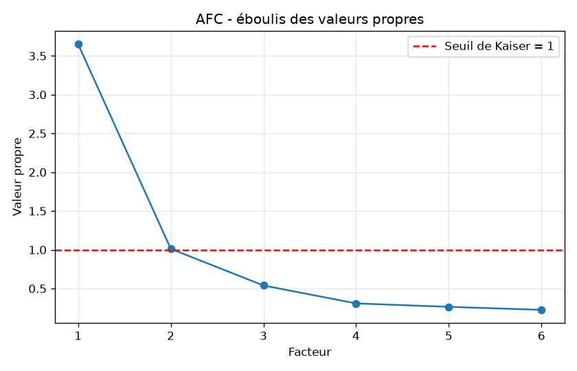{width=70%}

Les trois rotations demandées dans le TD, sans rotation, varimax et quartimax, sont représentées sur ces deux facteurs. Les types sont en bleu et les couleurs en rouge.

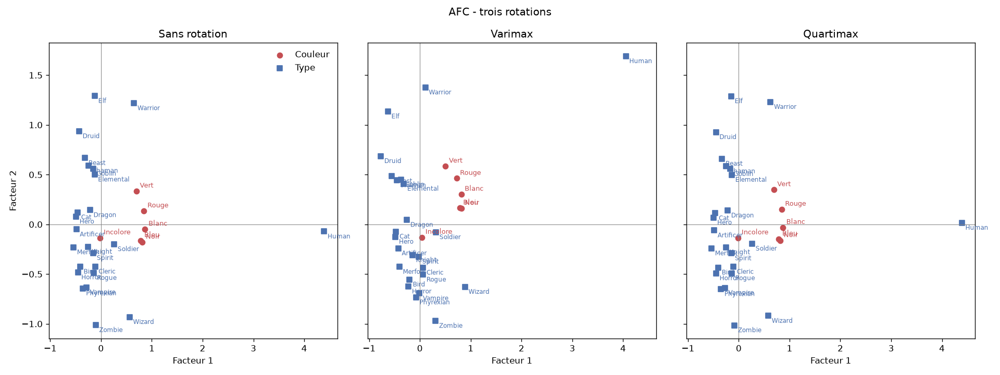{width=98%}

Sans rotation, le premier facteur est fortement influencé par **Human**, qui correspond de loin à la ligne la plus lourde du tableau. Les couleurs restent alors proches du centre. La rotation varimax donne une lecture plus nette des associations entre couleurs et types. Vert et Rouge se situent du côté de Elf, Druid et Warrior, tandis que Noir et Bleu se trouvent du côté de Zombie et Wizard. Quartimax reste proche de la solution sans rotation.

Nous retenons donc deux facteurs pour cette représentation. La rotation varimax fait mieux apparaître les familles de couleur, tandis que les parts de ligne permettent de préciser leur répartition.

# 6. ACM

L'ACM complète l'analyse en ajoutant la rareté et en utilisant **une ligne par créature**. Pour le type, seul le premier sous-type est conservé. Lorsqu'il ne fait pas partie des 24 types retenus dans l'AFC, il est remplacé par la catégorie "Autre". Les raretés qui apparaissent moins de 50 fois sont également regroupées dans "autre".

Le tableau disjonctif contient 19 169 lignes et 33 modalités. Nous utilisons `MCA` selon la méthode du cours, sans appliquer de correction de Benzécri.

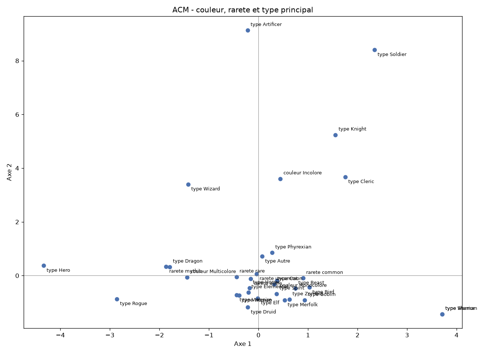{width=80%}

Sur l'axe 1, le multicolore (-1,439) et le mythique (-1,865) se trouvent à gauche, près de Dragon et Rogue, tandis que la rareté commune se situe à droite avec une coordonnée de 0,900. L'incolore est particulièrement éloigné sur l'axe 2, avec une coordonnée de 3,608. La majorité des modalités reste cependant concentrée autour du centre, notamment les différents types et la catégorie monocolore.

La lecture de l'ACM ne correspond pas exactement à celle de l'AFC. Dans l'AFC, une carte pouvait contribuer avec plusieurs de ses sous-types. Dans l'ACM, seul le premier sous-type est conservé. Soldier, Knight, Artificer et Cleric sont donc éloignés sur l'axe 2, avec notamment Soldier à 8,404 et Artificer à 9,133. Ils sont moins fréquents comme premier type que lorsqu'ils sont comptés à chaque apparition dans l'AFC. Nous n'interprétons donc pas ces coordonnées comme une nouvelle famille de types.

Shaman et Warrior ont les mêmes coordonnées, 3,710 et -1,434. Le journal produit ces coordonnées identiques, sans fournir d'explication supplémentaire. Nous nous en tenons donc à ce résultat.

L'ACM confirme surtout que le mythique et le multicolore s'écartent du profil le plus courant. Pour les associations précises entre une couleur et un type, les parts de ligne de l'AFC restent plus faciles à interpréter.

# 7. Partitionnement

Le k-means et la CAH utilisent la même matrice standardisée que l'ACP, sur les 18 025 créatures retenues. Nous utilisons ces méthodes pour voir si les dimensions mises en évidence par l'ACP correspondent également à des groupes de créatures.

## K-means

|    k |  Inertie |    k |  Inertie |
| ---: | -------: | ---: | -------: |
|    2 | 79 161,1 |    7 | 43 000,2 |
|    3 | 65 991,4 |    8 | 40 378,4 |
|    4 | 58 129,7 |    9 | 38 209,8 |
|    5 | 51 673,3 |   10 | 36 323,5 |
|    6 | 46 500,1 |      |          |

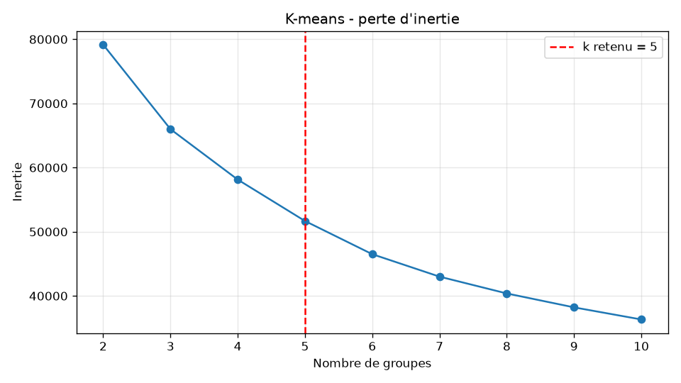{width=75%}

La diminution de l'inertie est régulière et ne présente pas de coude très net. Avec la règle du point le plus éloigné de la droite reliant k = 2 à k = 10, nous retenons **k = 5**. Ce choix reste cependant dépendant de la règle utilisée, et des valeurs voisines pourraient également être défendues.

Les moyennes obtenues pour les cinq groupes sont les suivantes :

| Groupe |     n | Mana |  Prix | Impr. | Force | End. | Rareté |
| -----: | ----: | ---: | ----: | ----: | ----: | ---: | -----: |
|      0 | 1 684 | 6,48 |  3,00 |  3,94 |  5,97 | 6,07 |   3,06 |
|      1 | 4 332 | 4,72 |  0,36 |  1,69 |  3,43 | 3,64 |   1,83 |
|      2 | 6 690 | 2,47 |  0,34 |  1,69 |  1,65 | 1,83 |   1,42 |
|      3 | 3 870 | 3,09 |  1,05 |  5,29 |  2,13 | 2,41 |   2,72 |
|      4 | 1 449 | 3,81 | 27,87 |  4,79 |  2,76 | 3,15 |   3,29 |

Rareté 1 = commune, 2 = peu commune, 3 = rare. Impr. = nombre d'impressions. Les moyennes sont calculées à partir des cartes appartenant à chaque groupe et sont exprimées dans les unités d'origine. Les cartes citées ensuite sont celles qui sont les plus proches du centre du groupe dans l'espace standardisé.

- **Groupe 0** : il rassemble les grosses créatures, avec environ 6 de force, 6 d'endurance et 6,5 de mana. Elles sont plutôt rares et leur prix moyen est de 3 dollars. Parmi les cartes proches du centre, on trouve `Numot, the Devastator`, `Gilgamesh, Master-at-Arms` et `Elder Brain`.
- **Groupe 1** : il correspond à un gabarit moyen, avec un prix faible de 0,36 dollar et peu de rééditions. `Memory Guardian` et `Henge Guardian` sont proches du centre.
- **Groupe 2** : il regroupe les petites créatures, souvent communes, avec un prix moyen de 0,34 dollar. `Mother Bear` et `Throne Warden` se trouvent près du centre.
- **Groupe 3** : ces créatures ont davantage d'impressions, avec une moyenne de 5,29, pour un prix autour d'un dollar et un gabarit modeste. Ce groupe correspond principalement aux créatures rééditées. Parmi les cartes proches du centre, on trouve `Squee, Dubious Monarch` et `Vaan, Street Thief`.
- **Groupe 4** : son prix moyen atteint 27,87 dollars, alors que le gabarit reste relativement ordinaire, avec 3,81 de mana et 2,76 de force. Les cartes proches du centre comprennent `Graveborn Muse`, `Kalemne, Disciple of Iroas` et `Michiko Konda, Truth Seeker`. La moyenne du prix est fortement influencée par quelques cartes très chères. Elle décrit donc le groupe dans son ensemble et non le prix d'une créature typique. Ce groupe n'est pas celui des plus grosses créatures.

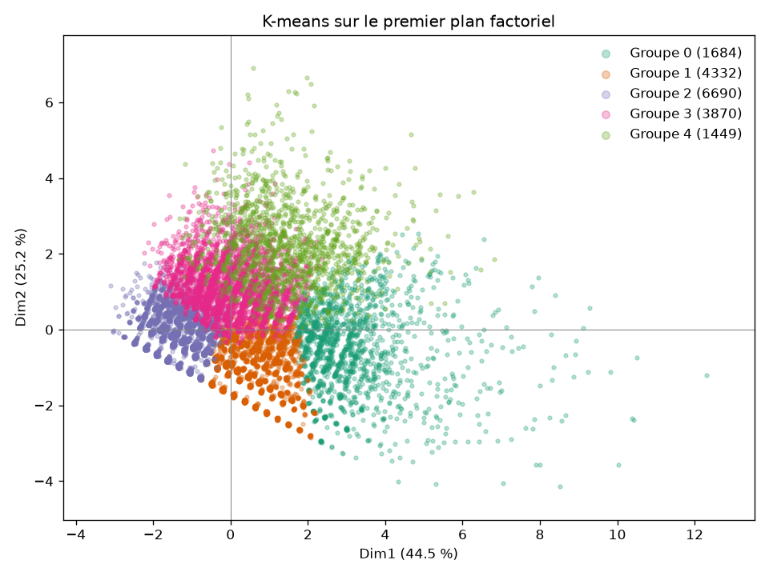{width=75%}

Dans cette partition, le groupe 0 se situe principalement du côté du gabarit sur Dim1. Le groupe 4 correspond davantage à la dimension du prix et le groupe 3 à celle des rééditions sur Dim2. Le partitionnement retrouve donc une séparation déjà visible dans l'ACP, tout en restant dépendant du choix de k.

## Classification ascendante hiérarchique

Une CAH de Ward sur les 18 025 lignes est lourde et le dendrogramme complet serait difficile à lire. Nous utilisons donc un échantillon de **3 000** créatures, avec une graine fixée à 0, puis nous tronquons le dendrogramme au niveau 4 comme indiqué dans la feuille de triche.

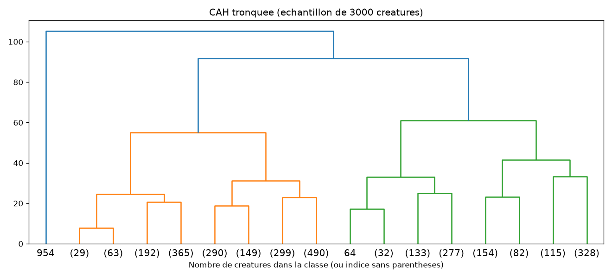{width=90%}

Le plus grand écart vertical apparaît en haut du dendrogramme et sépare **deux** grandes familles. Un niveau plus bas fait plutôt apparaître trois blocs. Nous ne cherchons pas à faire correspondre ce découpage aux cinq groupes du k-means. Le k-means fournit ici des profils plus détaillés, tandis que la CAH montre surtout que l'échantillon ne forme pas un seul groupe homogène.

# 8. Bonus : k plus proches voisins et arbre

Nous cherchons à prédire la classe de prix des 18 025 créatures retenues pour l'ACP, **sans utiliser le prix** comme variable prédictive. Les prédicteurs sont le mana, la force, l'endurance, la rareté et le logarithme du nombre d'impressions. Pour chaque découpe, les cinq seuils sont calculés à partir des prix du jeu d'apprentissage, puis appliqués au jeu de test.

Nous réalisons dix découpes stratifiées, avec 80 % des données pour l'apprentissage et 20 % pour le test. Les variables utilisées par le kNN sont standardisées dans chaque découpe. L'arbre de décision n'a pas besoin de cette standardisation. La plus grande classe représente en moyenne 21,1 % du test.

| Modèle                 | Exactitude moyenne | Écart-type |
| ---------------------- | -----------------: | ---------: |
| kNN, k = 3             |              0,376 |      0,008 |
| kNN, k = 5             |              0,388 |      0,004 |
| kNN, k = 7             |              0,404 |      0,010 |
| kNN, k = 11            |              0,410 |      0,007 |
| kNN, k = 15            |              0,420 |      0,005 |
| Arbre, critère de Gini |              0,409 |      0,007 |
| Arbre, entropie        |              0,409 |      0,008 |

Parmi les modèles testés, le **kNN à 15 voisins** obtient l'exactitude moyenne la plus élevée, avec 42,0 %. L'exactitude augmente progressivement lorsque le nombre de voisins passe de 3 à 15. Les deux arbres obtiennent 40,9 %, avec des résultats presque identiques pour Gini et l'entropie.

À 42,0 % d'exactitude, plus de la moitié des créatures du test restent mal classées. Les variables utilisées contiennent donc un signal sur la classe de prix, mais elles ne permettent pas de la prédire précisément.

# 9. Conclusion

Chez les créatures, **la taille, le coût en mana et l'endurance vont ensemble**. Les charges de Dim1 dépassent 0,80 pour ces trois variables, tandis que le prix retail n'y atteint que 0,45. Le prix est davantage lié à la **rareté**, avec une corrélation de 0,50 et une charge de 0,656 sur Dim2, ainsi qu'aux rééditions dans une moindre mesure. Dans la partition k = 5, les grosses créatures forment un groupe autour de 6 de mana et de 3 dollars en moyenne, tandis que les créatures du groupe le plus cher ont un gabarit plus ordinaire. Le choix de k = 5 reste cependant dépendant de la règle utilisée, car le coude du k-means n'est pas très marqué.

La couleur est associée à **certains types** de créatures, à condition de regarder la proportion de chaque couleur dans la ligne plutôt que l'effectif brut. Les Gobelins sont majoritairement rouges, les Elfes et les Druides majoritairement verts, les Zombies et les Vampires majoritairement noirs, les Ondins et les Sorciers majoritairement bleus, et les Soldats et les Clercs majoritairement blancs. Les Humains sont présents dans les cinq couleurs, leur catégorie blanche ne représentant que 30,8 % de leur ligne. Les Dragons restent également répartis entre plusieurs couleurs. L'identité de couleur ne sépare pas nettement le plan de l'ACP, car elle semble davantage liée aux types de créatures qu'au gabarit ou au prix.

Limites :

- le prix correspond au retail papier du 1er octobre 2026, en dollars, chez TCGPlayer, Card Kingdom et Mana Pool. La moyenne du groupe le plus cher est fortement influencée par quelques cartes très chères
- 1 144 créatures sont exclues de l'ACP parce que leur force, leur endurance ou leur prix n'est pas numérique
- l'AFC compte des couples type-couleur plutôt que des cartes une seule fois. Une créature possédant plusieurs types ou plusieurs couleurs peut donc contribuer à plusieurs cases
- les types apparaissant moins de 400 fois ne sont pas inclus dans l'AFC
- `B.F.M. (Big Furry Monster)` reste hors du cadre des figures, avec des coordonnées de 57,98 sur Dim1 et -28,65 sur Dim2
- la troisième composante de l'ACP est sous le seuil de Kaiser et n'est donc pas interprétée comme une dimension principale
- le choix de k = 5 repose sur une règle appliquée à une courbe d'inertie sans coude net
- la CAH est réalisée sur un échantillon de 3 000 créatures plutôt que sur les 18 025 observations.

Sur les prix retail papier du 1er octobre 2026, le gabarit et le prix ne vont donc pas ensemble. **Une grosse créature coûte cher à jouer, pas forcément cher à acheter. Un type de créature a souvent une couleur, et les Humains, le type le plus nombreux, en ont plusieurs.**

# Annexe - correspondance avec la check-liste

| Attendu                                    | Où c'est traité                                                                            |
| ------------------------------------------ | ------------------------------------------------------------------------------------------ |
| Code source et données, ou un lien         | `main.py`, `construire_cartes.py`, le dossier `analyse/` et `data/cards.csv`               |
| Introduction, constitution du groupe       | section 1 : Keren Courtois et Célestin Cécilien                                            |
| Description du jeu de données              | section 2                                                                                  |
| Nettoyage                                  | section 3                                                                                  |
| ACP : standardisation                      | section 3, contrôle moyenne 0 / écart-type 1                                               |
| ACP : entraînement                         | section 4, `PCA` de scikit-learn                                                           |
| ACP : choix du nombre de composantes       | règle de Kaiser, 2 composantes, 69,7 % sur le premier plan                                 |
| ACP : valeurs singulières et % de variance | tableau de la section 4, `figures/acp_variance.png`                                        |
| ACP : biplot et corrélations               | charges de la section 4, `figures/acp_correlation.png`, `acp_cercle.png`, `acp_biplot.png` |
| ACP : plan factoriel des individus         | `figures/acp_individus.png` et `acp_individus_couleurs.png`                                |
| AFC : deux variables, contingence          | section 5, type de créature x couleur, `figures/afc_contingence.png`                       |
| AFC : Bartlett et khi-deux                 | section 5                                                                                  |
| AFC : standardisation                      | tableau centré-réduit avant `FactorAnalyzer`                                               |
| AFC : FactorAnalyzer                       | section 5                                                                                  |
| AFC : scree plot                           | `figures/afc_scree.png`                                                                    |
| AFC : trois rotations                      | `figures/afc_rotations.png`                                                                |
| ACM : tableau disjonctif                   | section 6, 19 169 x 33                                                                     |
| ACM : modèle et graphique                  | `MCA`, `figures/acm_modalites.png`                                                         |
| K-means et inertie                         | section 7, bonus pour un groupe de deux, `figures/clustering_inertie.png`                  |
| Dendrogramme                               | `figures/clustering_dendrogramme.png`                                                      |
| Explications                               | sections 4 à 8                                                                             |
| Conclusion et déclaration d'IA             | sections 9 et 10                                                                           |
| Bonus supervisé                            | section 8                                                                                  |
